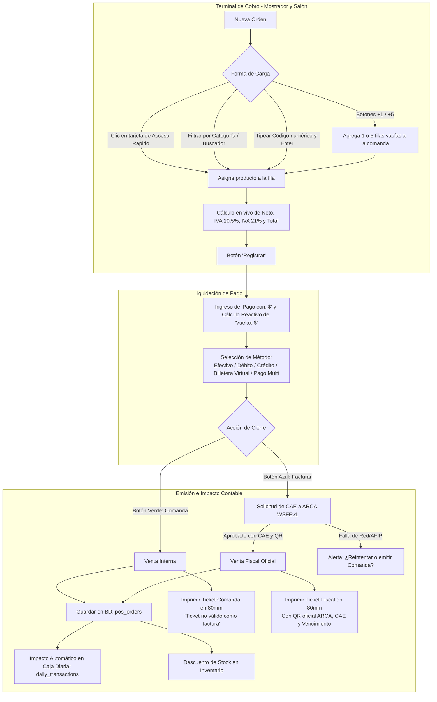

# Especificación Integral: Sistema POS Mostrador/Salón, Productos Personalizados, Caja Diaria y Facturación ARCA — "Dulce Hora"

Este documento contiene la arquitectura técnica completa, diseño de pantallas, catálogo oficial de productos con precios y códigos, módulo de **Productos Personalizados**, configuración de **Acceso Rápido**, categorización dinámica, flujo de comandas/mesas, e integración fiscal para implementar el nuevo módulo de **Punto de Venta (POS)** en **Tutto Passa**.

---

## 1. Identidad del Local y Datos Fiscales

Todos los comprobantes (tanto el ticket de comanda interna como la factura oficial electrónica) se emiten bajo los datos operativos reales del negocio:

* **Nombre de Fantasía:** Dulce Hora Villa Pueyrredon
* **Titular:** DONATO PABLO GABRIEL
* **CUIT:** 20-44362103-3
* **Ingresos Brutos (IB):** 20443621033
* **Domicilio Fiscal / Comercial:** MOSCONI GRAL AV. 2268, Villa Pueyrredón, CABA
* **Inicio de Actividades:** 01/06/2024
* **Condición de IVA:** Monotributista
* **Punto de Venta Web Service Predeterminado:** 0002

---

## 2. Visión General del Flujo Operativo



---

## 3. Especificación de la Interfaz de Usuario (UI/UX)

La pantalla se distribuye en **3 zonas de trabajo principales**:

```
┌────────────────────────────────────────────────────────────────────────────────────────┐
│ [Home]         (Logo Dulce Hora) Panel de control - Facturación         [pueyrredon]   │
├───────────────────────────────┬──────────────────────────────────────────┬─────────────┤
│ Facturacion               (●) │ [ACCESOS RÁPIDOS CONFIGURABLES]          │ [$] Caja    │
│ ┌───────────────────────────┐ │ [Medialunas] [Criollos] [Chipa] [Cremona]│ [📝] Nota    │
│ │Cód Producto Cant Med Pr Sub│ │ [Tartas]     [Café]     [Budines] [Promos]│ [🗑️] Vaciar  │
│ │207 CRIOLLO   250  gr ...  │ ├──────────────────────────────────────────┤ [☕] Mesas   │
│ │208 CREMONA     1  un ...  │ │ [Buscador: 🔍 Buscar producto...]        │ [⚙️] ABM    │
│ │  0             0   0 $0   │ │ CATEGORÍAS (Pestañas / Tabs):            │ [⛶] Fullscr │
│ └───────────────────────────┘ │ [★ Rápidos] [☕ Cafetería] [🥐 Facturas]  │             │
│ [+1]  [+5]                    │ [🥖 Panadería] [🍰 Pastelería] [🥪 Salado]│             │
│ ┌───────────────────────────┐ │ [🏷️ Promos]                             │             │
│ │Neto: $...  IVA 10.5%: $...│ ├──────────────────────────────────────────┤             │
│ │IVA 21%: $... Total: $...  │ │ [Grid dinámico de productos filtrados]   │             │
│ └───────────────────────────┘ │                                          │             │
│ [  Limpiar  ]  [ Registrar ] │                                          │             │
└───────────────────────────────┴──────────────────────────────────────────┴─────────────┘
```

### 3.1 Panel Izquierdo: Grilla de Facturación / Comanda (Ancho ~35%)
* **Card contenedor:** Blanco con bordes redondeados, cabecera `"Facturacion"` y luz de estado en verde.
* **Tabla dinámica de renglones:**
  * **Cód:** Código numérico de producto (ej: `207`, `100`, `1`). Al ingresar el código y pulsar `Enter`, busca el producto, completa la descripción, unidad y precio, y enfoca el campo de cantidad.
  * **Producto:** Nombre comercial descriptivo.
  * **Cant:** Campo numérico editable con flechas de incremento/decremento directo.
  * **Medida:** Etiqueta dinámica: `gramos`, `unidad`, `docena`, `1/2 docena`, `paquete`, `porcion`.
  * **Precio:** Precio unitario de lista vigente.
  * **Subtotal:** Cálculo exacto (`Cantidad * Precio` para unidades, o `(Gramos / 1000) * Precio_Kg` para productos pesados).
  * **X:** Botón de eliminación rápida del renglón.
* **Comportamiento de los botones `[ +1 ]` y `[ +5 ]`:**
  * **Función:** **Agregan 1 o 5 filas vacías a la tabla de la comanda.**
  * Permiten que el cajero prepare múltiples renglones para escribir códigos consecutivos con teclado físico o lector de código de barras sin tocar el mouse.
* **Zócalo de Liquidación de Impuestos:**
  * **Neto:** Base imponible acumulada.
  * **IVA 10,5%:** Impuesto calculado para panadería, panificados y harinas básicas.
  * **IVA 21%:** Impuesto calculado para cafetería, bebidas, postres y pastelería general.
  * **Total:** Monto final a pagar destacado en tipografía grande y negrita.
* **Botones de Pie:**
  * `[ Limpiar ]` (Naranja): Deja la tabla en su estado inicial con filas vacías en `$0`.
  * `[ Registrar ]` (Verde): Abre el modal de cobro y liquidación.

### 3.2 Panel Central: Accesos Rápidos, Buscador y Categorías Dinámicas
El panel derecho se divide en 3 bloques sincronizados:

#### A. Módulo de Accesos Rápidos (Grid Superior Configurable):
* Muestra de 8 a 12 tarjetas visuales fijas con los productos de mayor rotación del negocio (ej: Medialunas, Criollos, Chipá, Café Jarrito, Cremona, Tarta Frola, etc.).
* **Personalización total:** El usuario puede seleccionar y modificar en cualquier momento qué productos aparecen en este grid desde la sección de administración de productos o haciendo clic derecho/presión larga sobre una tarjeta.
* Al hacer clic sobre una tarjeta de acceso rápido, se añade instantáneamente a la comanda:
  * Si hay filas vacías, llena la primera disponible.
  * Si la tabla está completa, agrega una fila automáticamente.
  * Si el producto es por peso (`gramos`), asigna por defecto `250` gramos (con posibilidad de cambiarlo en la fila).

#### B. Barra de Búsqueda y Selector de Categorías (Tabs):
* **Buscador en vivo:** Campo de texto `🔍 Buscar por nombre o código...` que filtra los productos a medida que se escribe.
* **Pestañas de Categoría:**
  * `★ Acceso Rápido` (Los favoritos del local).
  * `☕ Cafetería & Bebidas` (Pocillo, Jarrito, Mocca, Capuccino, Té, etc.).
  * `🥐 Facturería` (Medialunas dulces y grasa, surtidas dulces y saladas).
  * `🥖 Panadería & Bizcochería` (Pan francés, campo, bizcochos, criollos, cremonas, chipá).
  * `🍰 Pastelería & Tortas` (Postres en pote, pastelería seca x 250g, budines, tortas).
  * `🥪 Sector Salado` (Sandwiches de miga, tostados, tartas individuales, pizzas, wraps).
  * `🏷️ Promos del Local` (Combos especiales de cafetería + facturas/tortas).

#### C. Grid de Productos Filtrados:
* Muestra las tarjetas con foto, nombre, formato de venta y precio de la categoría seleccionada para agregar al carrito con un solo toque.

### 3.3 Barra Lateral Flotante de Herramientas
* **Icono Dinero ($):** Ventana emergente con el arqueo acumulado de la Caja Diaria en tiempo real.
* **Icono Nota (📝):** Permite ingresar observaciones a la comanda (ej: *"calentar tostado"*, *"para llevar"*).
* **Icono Vaciar (🗑️):** Cancelación rápida de la comanda en curso.
* **Icono Taza de Café (☕) - Módulo de Mesas:**
  * Abre el modal de **Gestión de Mesas de Salón**:
    * Cuadrícula con `Mesa 1`, `Mesa 2` ... `Mesa 10+`.
    * Cada mesa muestra estado: **Cerrada (Disponible)** o **Abierta (Ocupada con $ acumulado)**.
    * Botón `[ Abrir ]` para asignar un cliente.
    * Al hacer clic en una mesa abierta, traslada sus consumos a la comanda para seguir adicionando o cerrarla.
    * Botón verde **`[ + Agregar ]`** para sumar nuevas mesas dinámicamente.
* **Icono Ajustes / Productos Propios (⚙️):** Acceso directo al panel de **Productos Personalizados** (ABM).
* **Icono Pantalla Completa (⛶):** Oculta toda la barra de navegación del navegador para operar en pantalla táctil completa.

### 3.4 Modal de Cobro y Cierre de Venta
Se activa al presionar el botón verde `[ Registrar ]`:
* **Encabezado:**
  * `Total: $ XX.XXX,00` (Destacado en grande).
  * `Pago: [ input numérico editable ]` (Recibe el importe entregado por el cliente).
  * `Vuelto: $ 0,00` (Calcula dinámicamente: `Pago - Total`).
* **Métodos de Pago (Radio Buttons):**
  * `(•) Efectivo`
  * `( ) Débito` (Payway)
  * `( ) Crédito` (Payway)
  * `( ) Billetera Virtual` (Mercado Pago)
  * `[ ✖ Pago Multi ]`: Despliega dos campos para cobrar una parte en efectivo y otra por medios electrónicos.
* **Botones de Cierre de Transacción:**
  * 🟢 **`[ Comanda ]` (Verde):** Cierra la venta como comprobante interno. Dispara la impresión del ticket no fiscal en la comandera y asienta el ingreso en la Caja Diaria.
  * 🔵 **`[ Facturar ]` (Azul):** Solicita el CAE a ARCA. Cierra la venta como comprobante fiscal oficial. Dispara la impresión del ticket con CAE y Código QR fiscal y asienta el ingreso en la Caja Diaria.
  * 🔴 **`[ Cancelar ]` (Rojo):** Cierra el modal y mantiene la comanda intacta para continuar atendiendo.

---

## 4. Módulo de Productos Personalizados y Configuración de Accesos Rápidos

El sistema cuenta con una sección dedicada a la gestión de productos propios (como el menú de cafetería, desayunos y promociones creadas por el local):

```
┌────────────────────────────────────────────────────────────────────────────────────────┐
│ Productos Personalizados                    [ + Agregar ]                              │
├─────────┬─────────────────────────┬──────────────┬────────┬────────┬───────┬───────────┤
│ Código  │ Nombre / Descripción    │ Categoría    │ Precio │ IVA    │ Estado│ Acciones  │
├─────────┼─────────────────────────┼──────────────┼────────┼────────┼───────┼───────────┤
│ 1       │ Pocillo (espresso)      │ Cafetería    │ $ 2800 │ 21.0%  │ Activo│ ⭐ Ed El  │
│ 2       │ Jarrito (café jarrito)  │ Cafetería    │ $ 3800 │ 21.0%  │ Activo│ ⭐ Ed El  │
│ 12      │ CAFE MED + MEDI MESA    │ Promos       │ $ 5500 │ 21.0%  │ Activo│ ⭐ Ed El  │
│ 13      │ PORCION TOR + CAFE      │ Promos       │ $13000 │ 21.0%  │ Activo│ ⭐ Ed El  │
└─────────┴─────────────────────────┴──────────────┴────────┴────────┴───────┴───────────┘
```

### 4.1 Formulario / Modal: "Nuevo Producto Personalizado"
Campos configurables para cada artículo:
1. **Código:** Número único del producto (ej: `1`, `12`, `500`).
2. **Nombre:** Denominación corta para el ticket y botón (ej: `Pocillo`, `CAFE MED + MEDI MESA`).
3. **Descripción:** Detalle ampliado para el catálogo (ej: `CAFÉ JARRITO CON 2 MEDIALUNAS`).
4. **Categoría:** Menú desplegable para asignarlo a su sector (*Cafetería, Facturas, Panadería, Pastelería, Salado, Promos*).
5. **Precio:** Valor de venta al público en pesos.
6. **Alícuota de IVA:** Selector de tasa fiscal:
   * `21%` (Cafetería, bebidas, pastelería elaborada, salados).
   * `10.5%` (Panadería, panificados, harinas básicas).
   * `Exento / 0%`.
7. **Formato / Unidad de Medida:** `unidad`, `docena`, `1/2 docena`, `gramos`, `paquete`, `porcion`.
8. **Imagen / Icono:** Opción de subir fotografía o seleccionar un icono representativo.
9. **⭐ Fijar en Acceso Rápido:** Casilla de verificación para determinar si este producto debe figurar en el grid principal de botones de la pantalla de mostrador.
10. **Estado:** Casilla `Activo` / `Inactivo` (permite ocultar temporalmente productos sin stock).

---

## 5. Catálogo Oficial Completo: Códigos, Precios y Medidas (Dulce Hora)

A continuación se detalla la base de datos completa de productos clasificados por sector, códigos oficiales, unidades de medida y precios de venta al público:

### 5.1 Sector Cafetería y Productos Propios del Local
| Cód | Nombre | Descripción | Precio Venta ($) | IVA (%) | Formato Venta |
| :---: | :--- | :--- | :---: | :---: | :---: |
| **1** | Pocillo | Espresso en pocillo | $ 2.800,00 | 21.0% | UNIDAD |
| **2** | Jarrito | Café en jarrito | $ 3.800,00 | 21.0% | UNIDAD |
| **3** | Desayuno | Café desayuno doble | $ 4.800,00 | 21.0% | UNIDAD |
| **5** | MOCCA | Café mocca con chocolate | $ 5.300,00 | 21.0% | UNIDAD |
| **6** | CAPUCCINO | Capuccino italiano | $ 5.300,00 | 21.0% | UNIDAD |
| **7** | ESPECIAL | Café especial con jarabes | $ 6.000,00 | 21.0% | UNIDAD |
| **8** | TÉ | Té en hebras a elección | $ 4.500,00 | 21.0% | UNIDAD |
| **9** | TÉ CON LECHE | Té en hebras con leche | $ 5.000,00 | 21.0% | UNIDAD |
| **10** | MATECOCIDO | Matecocido clásico | $ 3.000,00 | 21.0% | UNIDAD |
| **11** | CHOCOLATADA | Submarino / Chocolatada | $ 4.000,00 | 21.0% | UNIDAD |
| **12** | CAFE MED + MEDI MESA | Café jarrito con 2 medialunas | $ 5.500,00 | 21.0% | UNIDAD (PROMO) |
| **13** | PORCION TOR + CAFE | Porción de torta a elección + café jarrito | $ 13.000,00 | 21.0% | UNIDAD (PROMO) |

### 5.2 Sector Facturería
| Cód | Artículo | Formato Venta | Precio Venta ($) | IVA (%) |
| :---: | :--- | :--- | :---: | :---: |
| **100** | MEDIALUNAS DULCES | DOCENA | $ 7.000,00 | 10.5% |
| **1011**| MEDIALUNAS DE GRASA | DOCENA | $ 7.000,00 | 10.5% |
| - | MEDIALUNAS / FACTURAS (FRACCIONADO) | 1/2 DOCENA | $ 4.500,00 | 10.5% |
| - | MEDIALUNA / FACTURA INDIVIDUAL | UNIDAD | $ 750,00 | 10.5% |
| **102** | SURTIDA DULCE MOÑO NIDITO TRENZA | DOCENA | $ 8.500,00 | 10.5% |
| **103** | TORTAS NEGRA | DOCENA | $ 8.500,00 | 10.5% |
| **104** | TRENZAS | DOCENA | $ 8.500,00 | 10.5% |
| **105** | TRIANGULITOS | DOCENA | $ 8.500,00 | 10.5% |
| **106** | VIGI DULCE | DOCENA | $ 8.500,00 | 10.5% |
| **107** | BOLITA BATATA | DOCENA | $ 8.500,00 | 10.5% |
| **108** | CONCHIS | DOCENA | $ 8.500,00 | 10.5% |
| **109** | CULIS | DOCENA | $ 8.500,00 | 10.5% |
| **110** | LENGUITAS | DOCENA | $ 8.500,00 | 10.5% |
| **111** | SACRA VACIO | DOCENA | $ 8.500,00 | 10.5% |
| **112** | SANTIAGUEÑAS | DOCENA | $ 8.500,00 | 10.5% |
| **113** | VIGI CORTO | DOCENA | $ 8.500,00 | 10.5% |
| **114** | VIGI LARGO | DOCENA | $ 8.500,00 | 10.5% |
| **115** | SURTIDA SALADA SANTIA CONCHI LENGUI | DOCENA | $ 8.500,00 | 10.5% |
| **116** | HOJALDRE DULCE | DOCENA | $ 8.500,00 | 10.5% |
| **117** | HOJALDRE FRUTA | DOCENA | $ 8.500,00 | 10.5% |
| **118** | HOJALDRE VARITA | DOCENA | $ 8.500,00 | 10.5% |

### 5.3 Sector Panadería y Bizcochería
| Cód | Artículo | Formato Venta | Precio Venta ($) | IVA (%) |
| :---: | :--- | :--- | :---: | :---: |
| **200** | PAN FRANCES LATA | UNIDAD / KILO | $ 400,00 (u) / $ 4.000,00 (kg) | 10.5% |
| **201** | PAN DE SALVADO LATA | UNIDAD / KILO | $ 500,00 (u) / $ 4.800,00 (kg) | 10.5% |
| **202** | PAN DE CAMPO | UNIDAD | $ 2.530,00 | 10.5% |
| **203** | FIGAZA DE MANTECA | KILO | $ 4.400,00 | 10.5% |
| **218** | MIÑON FRANCES | KILO | $ 4.200,00 | 10.5% |
| **219** | MIÑON SALVADO | KILO | $ 4.900,00 | 10.5% |
| **206** | BIZCOCHO DE GRASA | 250 GRS / KILO | $ 3.200,00 (250g) / $ 12.800,00 (kg)| 10.5% |
| **207** | CRIOLLO | 250 GRS / KILO | $ 3.600,00 (250g) / $ 14.400,00 (kg)| 10.5% |
| **208** | CREMONA | UNIDAD | $ 2.600,00 | 10.5% |
| **209** | CHIPA | 250 GRS / KILO | $ 5.200,00 (250g) / $ 20.800,00 (kg)| 10.5% |
| **210** | PREPIZZA TOMATE | UNIDAD | $ 2.800,00 | 10.5% |
| **213** | BAGUETTE FRANCES | UNIDAD | $ 1.000,00 | 10.5% |
| **214** | BAGUETTE SALVADO | UNIDAD | $ 1.100,00 | 10.5% |
| **993** | PASTELITOS MEMBRILLO | UNIDAD / DOCENA | $ 1.600,00 (u) / $ 16.000,00 (doc) | 10.5% |
| **994** | PASTELITOS BATATA | UNIDAD / DOCENA | $ 1.600,00 (u) / $ 16.000,00 (doc) | 10.5% |
| **995** | PASTELITOS DDL | UNIDAD / DOCENA | $ 1.600,00 (u) / $ 16.000,00 (doc) | 10.5% |
| **418** | SCON DE QUESO | UNIDAD | $ 4.400,00 | 10.5% |

### 5.4 Sector Pastelería
#### A. Postres en Pote
| Cód | Artículo | Formato Venta | Precio Venta ($) | IVA (%) |
| :---: | :--- | :--- | :---: | :---: |
| **300** | POTE CHEESECAKE FRUTOS ROJOS | UNIDAD | $ 5.600,00 | 21.0% |
| **301** | POTE CHOCOTORTA | UNIDAD | $ 5.600,00 | 21.0% |
| **302** | POTE MOUSSE DE CHOCOLATE | UNIDAD | $ 5.200,00 | 21.0% |
| **303** | POTE OREO | UNIDAD | $ 5.600,00 | 21.0% |
| **304** | POSTRE CHEESECAKE MARACUYA | UNIDAD | $ 5.600,00 | 21.0% |
| **306** | POSTRE DURAZNO | UNIDAD | $ 5.600,00 | 21.0% |
| **307** | POSTRE TIRAMISU | UNIDAD | $ 5.200,00 | 21.0% |

#### B. Pastelería Seca (por 250 gramos)
| Cód | Artículo | Formato Venta | Precio Venta ($) | IVA (%) |
| :---: | :--- | :--- | :---: | :---: |
| **308** | PEPA MEMBRILLO | 250 GRS | $ 4.800,00 | 21.0% |
| **309** | PEPA BATATA | 250 GRS | $ 4.800,00 | 21.0% |
| **310** | COOKIES DE LIMON | 250 GRS | $ 6.200,00 | 21.0% |
| **311** | ROSQUITA MAICENA | 250 GRS | $ 6.700,00 | 21.0% |
| **312** | ALFAJORCITO MAICENA | 250 GRS | $ 6.200,00 | 21.0% |
| **313** | ALFAJORCITO AZUCAR IMPALPABLE | 250 GRS | $ 6.200,00 | 21.0% |
| **314** | ALFAJORCITO CHOCO NEGRO | 250 GRS | $ 6.200,00 | 21.0% |
| **315** | ALFAJORCITO CHOCO BLANCO | 250 GRS | $ 6.200,00 | 21.0% |
| **316** | CONITO NEGRO | 250 GRS | $ 6.200,00 | 21.0% |
| **317** | CONITO BLANCO | 250 GRS | $ 6.200,00 | 21.0% |
| **318** | PEPA MEMBRILLO C/ CHOCO | 250 GRS | $ 6.600,00 | 21.0% |
| **319** | PEPA DE CHOCO C/DDL | 250 GRS | $ 6.600,00 | 21.0% |
| **320** | ARITO C/ DDL Y CHOCO NEGRO | 250 GRS | $ 6.600,00 | 21.0% |
| **321** | ALFAJOR SANTAFESINO | 250 GRS | $ 6.200,00 | 21.0% |
| **603** | COOKIES X 200 GRS | 200 GRS | $ 4.800,00 | 21.0% |

#### C. Alfajores y Cookies Individuales
| Cód | Artículo | Formato Venta | Precio Venta ($) | IVA (%) |
| :---: | :--- | :--- | :---: | :---: |
| **322** | ALFAJOR DE MAICENA GRANDE | UNIDAD | $ 3.500,00 | 21.0% |
| **323** | ALFAJOR CHOCOLATE NEGRO | UNIDAD | $ 3.500,00 | 21.0% |
| **324** | ALFAJOR CHOCOLATE BLANCO | UNIDAD | $ 3.500,00 | 21.0% |
| **325** | ALFAJOR AZUCAR IMPALPABLE | UNIDAD | $ 3.500,00 | 21.0% |
| **379** | COOKIES DE CHOCOLATE | UNIDAD | $ 3.000,00 | 21.0% |
| **380** | COOKIES DE ROCKLETS | UNIDAD | $ 3.000,00 | 21.0% |
| **381** | COOKIES DE MANI | UNIDAD | $ 3.000,00 | 21.0% |

#### D. Budines y Pastafrolas
| Cód | Artículo | Formato Venta | Precio Venta ($) | IVA (%) |
| :---: | :--- | :--- | :---: | :---: |
| **326** | BUDIN VAINILLA | UNIDAD | $ 7.400,00 | 21.0% |
| **327** | BUDIN CHOCOLATE | UNIDAD | $ 7.400,00 | 21.0% |
| **328** | BUDIN MARMOLADO | UNIDAD | $ 8.900,00 | 21.0% |
| **329** | BUDIN LIMON | UNIDAD | $ 8.900,00 | 21.0% |
| **330** | BUDIN NARANJA | UNIDAD | $ 8.900,00 | 21.0% |
| **331** | BUDIN VAINILLA C/ CHIPS | UNIDAD | $ 9.500,00 | 21.0% |
| **332** | BUDIN VAINILLA C/ DDL | UNIDAD | $ 9.500,00 | 21.0% |
| **333** | BUDIN CHOCOLATE C/ DDL | UNIDAD | $ 9.500,00 | 21.0% |
| **334** | BUDIN ZANAHORIA | UNIDAD | $ 7.600,00 | 21.0% |
| **335** | BUDIN MARMOLADO DE 1KG | PORCION | $ 5.200,00 | 21.0% |
| **336** | BUDIN AMAPOLA Y LIMON 1KG | PORCION | $ 5.200,00 | 21.0% |
| **337** | TARTA FROLA DE MEMBRILLO | UNIDAD | $ 17.600,00 | 21.0% |
| **338** | TARTA FROLA DE BATATA | UNIDAD | $ 17.600,00 | 21.0% |
| **339** | TARTA FROLA BATATA Y MEMBRILLO | UNIDAD | $ 17.600,00 | 21.0% |

#### E. Tartas Húmedas, Tortas y Porciones
| Cód | Artículo | Formato Venta | Precio Venta ($) | IVA (%) |
| :---: | :--- | :--- | :---: | :---: |
| **340** | TARTA RICOTA | UNIDAD | $ 18.700,00 | 21.0% |
| **341** | TARTA RICOTA C/ DDL | UNIDAD | $ 18.700,00 | 21.0% |
| **342** | TARTA MANZANA | UNIDAD | $ 18.700,00 | 21.0% |
| **343** | TARTA DE COCO Y DDL | UNIDAD | $ 18.700,00 | 21.0% |
| **344** | PORCION MEMBRILLO | UNIDAD | $ 4.500,00 | 21.0% |
| **345** | PORCION BATATA | UNIDAD | $ 4.500,00 | 21.0% |
| **346** | PORCION BROWNIE | UNIDAD | $ 3.700,00 | 21.0% |
| **347** | PORCION BROWNIE LIMON | UNIDAD | $ 3.700,00 | 21.0% |
| **348** | PORCION BROWNIE NARANJA | UNIDAD | $ 3.700,00 | 21.0% |
| **349** | PORCION RICOTTA | UNIDAD | $ 6.800,00 | 21.0% |
| **350** | PORCION MANZANA | UNIDAD | $ 6.800,00 | 21.0% |
| **351** | TARTA DE BANANA | UNIDAD | $ 24.600,00 | 21.0% |
| **352** | LEMON PIE | UNIDAD | $ 20.600,00 | 21.0% |
| **353** | COPITOS NEGRO | UNIDAD | $ 25.100,00 | 21.0% |
| **354** | CHOCOTORTA BIZCOCHUELO GRANDE | UNIDAD | $ 30.700,00 | 21.0% |
| **355** | TIRAMISU | UNIDAD | $ 30.700,00 | 21.0% |
| **356** | ROGEL GRANDE | UNIDAD | $ 22.500,00 | 21.0% |
| **357** | TARTA FRUTILLA C/PASTELERA | UNIDAD | $ 38.500,00 | 21.0% |
| **358** | DULCE HORA GRANDE | UNIDAD | $ 20.500,00 | 21.0% |
| **359** | BALCARCE | UNIDAD | $ 38.500,00 | 21.0% |
| **360** | MOUSSE DE CHOCOLATE | UNIDAD | $ 26.700,00 | 21.0% |
| **361** | MULATA | UNIDAD | $ 29.700,00 | 21.0% |
| **362** | CHEESECAKE FRUTOS ROJOS | UNIDAD | $ 29.700,00 | 21.0% |
| **363** | CHEESECAKE OREO | UNIDAD | $ 28.600,00 | 21.0% |
| **364** | CHEESECAKE DDL | UNIDAD | $ 23.700,00 | 21.0% |
| **365** | CHEESECAKE DE MARACUYÁ | UNIDAD | $ 31.900,00 | 21.0% |
| **366** | TENTACION | UNIDAD | $ 29.700,00 | 21.0% |
| **367** | MATILDA | UNIDAD | $ 39.000,00 | 21.0% |
| **368** | RED VELVET | UNIDAD | $ 34.100,00 | 21.0% |
| **369** | BOMBOUSSE | UNIDAD | $ 34.200,00 | 21.0% |
| **370** | CHAJÁ | UNIDAD | $ 29.900,00 | 21.0% |
| **371** | TORTA FRUTAL | UNIDAD | $ 34.200,00 | 21.0% |
| **377** | SAMBAYON | UNIDAD | $ 27.500,00 | 21.0% |
| **378** | KEY LIME PIE | UNIDAD | $ 27.500,00 | 21.0% |
| **372** | MINI ROGEL | UNIDAD | $ 10.100,00 | 21.0% |
| **373** | MINI DULCE HORA | UNIDAD | $ 10.100,00 | 21.0% |
| **374** | MINI RED VELVET | UNIDAD | $ 10.100,00 | 21.0% |
| **375** | MINI MATILDA | UNIDAD | $ 10.100,00 | 21.0% |

### 5.5 Sector Salado
| Cód | Artículo | Formato Venta | Precio Venta ($) | IVA (%) |
| :---: | :--- | :--- | :---: | :---: |
| **500** | SANDWICH MIGA BLANCO J&Q | UNIDAD | $ 3.100,00 | 21.0% |
| **501** | SANDWICH MIGA NEGRO J&Q | PAQUETE (x6) | $ 18.600,00 | 21.0% |
| **502** | TOSTADO MIGA BLANCO J&Q | 4 UNIDADES | A elección | 21.0% |
| **503** | TOSTADO MIGA NEGRO J&Q | 4 UNIDADES | A elección | 21.0% |
| **504** | TARTA DE J&Q | UNIDAD | $ 8.000,00 | 21.0% |
| **505** | TARTA DE CAPRESE | UNIDAD | $ 8.000,00 | 21.0% |
| **506** | TARTA DE CALABAZA & Q | UNIDAD | $ 8.000,00 | 21.0% |
| **507** | TARTA DE CA/AC/CH&Q | UNIDAD | $ 8.000,00 | 21.0% |
| **508** | WRAP J&Q | UNIDAD | $ 8.000,00 | 21.0% |
| **509** | WRAP CARNE & CRIOLLA | UNIDAD | $ 8.600,00 | 21.0% |
| **510** | WRAP CAPRESE | UNIDAD | $ 8.000,00 | 21.0% |
| **511** | ENSALADA LECHUGA | UNIDAD | $ 8.300,00 | 21.0% |
| **512** | ENSALADA RUCULA | UNIDAD | $ 8.300,00 | 21.0% |
| **513** | PASTEL DE PAPA | UNIDAD | $ 10.900,00 | 21.0% |
| **514** | PASTEL DE CALABAZA | UNIDAD | $ 10.900,00 | 21.0% |
| **515** | ÁRABE CON J&Q | UNIDAD | $ 5.100,00 | 21.0% |
| **516** | PIZZA MUZZARELLA | UNIDAD | $ 10.900,00 | 21.0% |
| **517** | PIZZA CEBOLLA | UNIDAD | $ 10.900,00 | 21.0% |

---

## 6. Especificación de Impresión en Comandera (80mm)

### 6.1 Ticket de Comanda Interna (Salón / Mostrador)
Se imprime al hacer clic en **`[ Comanda ]` (Verde)**. Utiliza tipografía monoespaciada compacta y la leyenda no fiscal:

```text
================================================
          "Dulce Hora Villa Pueyrredon"
              DONATO PABLO GABRIEL
              CUIT 20443621033
              IB: 20443621033
              MOSCONI GRAL AV. 2268
              Inicio Act.: 1/6/2024
              Monotributista
------------------------------------------------
19/10/2026 - 13:08:16
Comanda Nº 1388
------------------------------------------------
Cant x precio (iva)
Descripción                            Importe
------------------------------------------------
250 x $ 14,40 (10.5%)
CRIOLLO                              $ 3.600,00
1 x $ 2.600,00 (10.5%)
CREMONA                              $ 2.600,00
250 x $ 20,80 (10.5%)
CHIPA                                $ 5.200,00
12 x $ 708,33 (10.5%)
SURTIDAS                             $ 8.500,00
1 x $ 3.800,00 (21.0%)
JARRITO                              $ 3.800,00
------------------------------------------------
TOTAL:                              $ 23.700,00
Forma de Pago: Efectivo (Pago: $25.000 / Vuelto: $1.300)
------------------------------------------------
            ¡Gracias por su compra!
         Ticket no válido como factura
================================================
```

### 6.2 Ticket Fiscal Oficial ARCA
Se imprime al hacer clic en **`[ Facturar ]` (Azul)**. Reemplaza el pie no fiscal por los datos regulatorios obligatorios:

```text
================================================
          "Dulce Hora Villa Pueyrredon"
              DONATO PABLO GABRIEL
              CUIT 20443621033
              IB: 20443621033
              MOSCONI GRAL AV. 2268
              Inicio Act.: 1/6/2024
              Monotributista
------------------------------------------------
FACTURA "C" - Consumidor Final
P.V. 0002 - Comp. Nro: 00000125
Fecha: 19/10/2026 13:08:16
------------------------------------------------
Cant x precio (iva)
Descripción                            Importe
------------------------------------------------
250 x $ 14,40 (10.5%)
CRIOLLO                              $ 3.600,00
1 x $ 2.600,00 (10.5%)
CREMONA                              $ 2.600,00
250 x $ 20,80 (10.5%)
CHIPA                                $ 5.200,00
12 x $ 708,33 (10.5%)
SURTIDAS                             $ 8.500,00
1 x $ 3.800,00 (21.0%)
JARRITO                              $ 3.800,00
------------------------------------------------
TOTAL:                              $ 23.700,00
Forma de Pago: Efectivo
------------------------------------------------
CAE: 74321234567890
Vto. CAE: 29/10/2026

            [ CÓDIGO QR OFICIAL ]
          (Imagen QR Base64 120x120)

        Comprobante Autorizado por ARCA
================================================
```

---

## 7. Integración con la Caja Diaria

Cada venta finalizada desde el POS ejecuta automáticamente en el backend:

1. **Búsqueda del arqueo abierto:** Consulta `daily_registers` con `status = 'open'` correspondiente al día de la fecha.
2. **Impacto en `daily_transactions`:**
   * **Tipo:** `'income'`.
   * **Categoría:** `'VENTA_MOSTRADOR'` o `'VENTA_SALON'` (si provino de una mesa).
   * **Monto:** Importe total de la comanda.
   * **Método de Pago:**
     * Si pagó en **Efectivo** -> `payment_method = 'Efectivo'` (computa en la caja física de billetes).
     * Si pagó con **Débito** o **Crédito** -> `payment_method = 'Payway'` (computa en Payway).
     * Si pagó con **Billetera Virtual** -> `payment_method = 'Mercado Pago'` (computa en Mercado Pago).
     * Si fue **Pago Multi** -> Inserta dos renglones separados en `daily_transactions` con sus importes parciales exactos.
   * **Descripción:** `"Comanda #1388 - Mostrador"` (o `"Factura C #125"`).
3. **Resultado:** El balance de caja, la conciliación de medios de pago y el arqueo al final del turno quedan 100% automatizados sin intervención manual.

## 8. Lógica de Inventario: Stock Manual vs. Descuento Automático

Para evitar desfasajes y errores en el control de mostrador, el sistema implementa una **regla de doble comportamiento de stock**, diferenciando los productos que se venden al peso o surtidos de aquellos de unidades fijas controlables:

```
┌──────────────────────────────────────────────────────────────────────────────────┐
│                                REGLA DE STOCK EN EL POS                          │
├─────────────────────────────────────────┬────────────────────────────────────────┤
│ 📦 GRUPO A: STOCK MANUAL                │ ⚡ GRUPO B: DESCUENTO AUTOMÁTICO       │
│ (NO descuenta con la venta en el POS)   │ (Se descuenta de inmediato con la venta)│
├─────────────────────────────────────────┼────────────────────────────────────────┤
│ • Todo el sector Medialunas y Facturas  │ • Pan de campo (Cód 202) [Excepción]   │
│   (Masa dulce, salada, docena, unidad)  │ • Prepizza (Cód 210) [Excepción]       │
│ • Todo el sector Bizcochería            │ • Postres en Pote (300 al 307)         │
│   (Bizcocho grasa, criollos, chipá,     │ • Alfajores Individuales y Cookies (322)│
│    cremonas, pan francés/salvado/miñón) │ • Budines enteros y porciones de kilo  │
│ • Baguettes francés y salvado (213, 214)│ • Pastafrolas y Tartas húmedas/porción │
│ • Pastelitos membrillo/batata/DDL (993) │ • Tortas frías enteras y Mini tortas   │
│ • Cookies secas al peso (310, 603)      │ • Todo el Sector Salado (Miga, tostados│
│ • Scon de queso (Cód 418)               │   tartas, wraps, ensaladas, pizzas)    │
├─────────────────────────────────────────┼────────────────────────────────────────┤
│ Razón: Al venderse surtidas, al peso o  │ Razón: Son unidades discretas y fijas. │
│ fraccionadas en mostrador, el descuento │ El control en tiempo real es exacto y  │
│ automático daría números erróneos.      │ no presenta desfasajes de mostrador.   │
│ Se auditan por carga/recuento manual.   │                                        │
└─────────────────────────────────────────┴────────────────────────────────────────┘
```

### 8.1 Cómo opera en el Backend (`/api/pos/checkout`)
Cada vez que se procesa una venta en el POS:
1. El backend recorre cada ítem del ticket y consulta su campo `auto_deduct_stock`.
2. **Si `auto_deduct_stock = 0` (Grupo Manual):**
   * Registra el cobro, calcula los totales y el ingreso en la Caja Diaria, pero **omite** generar movimiento de egreso en `stock_movements`.
   * El stock de estos productos se mantiene fijo hasta que el encargado cargue la producción o realice el recuento físico al inicio/cierre de turno.
3. **Si `auto_deduct_stock = 1` (Grupo Automático):**
   * Genera de forma inmediata un movimiento de salida (`type = 'delivery'`) en `stock_movements` restando la cantidad vendida.

---

## 9. Modelo de Base de Datos y Script de Migración

### 9.1 Migración SQL: `21_create_pos_system_tables.js`
```sql
-- 1. Ampliar tabla products con atributos de mostrador, favoritos y regla de stock
ALTER TABLE products 
ADD COLUMN description TEXT NULL,
ADD COLUMN price DECIMAL(12, 2) NOT NULL DEFAULT 0.00,
ADD COLUMN unit_measure VARCHAR(20) NOT NULL DEFAULT 'unidad',
ADD COLUMN iva_rate DECIMAL(4, 2) NOT NULL DEFAULT 10.50,
ADD COLUMN image_url VARCHAR(255) NULL,
ADD COLUMN is_promo BOOLEAN NOT NULL DEFAULT 0,
ADD COLUMN is_quick_access BOOLEAN NOT NULL DEFAULT 0,  -- ⭐ Determina si va al grid de acceso rápido
ADD COLUMN quick_access_order INT NOT NULL DEFAULT 0,
ADD COLUMN auto_deduct_stock BOOLEAN NOT NULL DEFAULT 1,-- ⚡ 1 = Descuenta automático | 0 = Stock manual
ADD COLUMN is_active BOOLEAN NOT NULL DEFAULT 1;

-- 2. Tabla de Mesas de Salón
CREATE TABLE IF NOT EXISTS pos_tables (
    id INT AUTO_INCREMENT PRIMARY KEY,
    table_number INT NOT NULL UNIQUE,
    name VARCHAR(50) NOT NULL,
    status ENUM('closed', 'open') NOT NULL DEFAULT 'closed',
    current_order_id INT NULL,
    opened_at DATETIME NULL,
    created_at TIMESTAMP DEFAULT CURRENT_TIMESTAMP
);

-- 3. Tabla de Cabecera de Ventas / Comandas
CREATE TABLE IF NOT EXISTS pos_orders (
    id INT AUTO_INCREMENT PRIMARY KEY,
    order_number INT NOT NULL,
    user_id INT NOT NULL,
    daily_register_id INT NULL,
    table_id INT NULL,
    date DATE NOT NULL,
    time TIME NOT NULL,
    
    neto_amount DECIMAL(12, 2) NOT NULL DEFAULT 0.00,
    iva_105_amount DECIMAL(12, 2) NOT NULL DEFAULT 0.00,
    iva_21_amount DECIMAL(12, 2) NOT NULL DEFAULT 0.00,
    total_amount DECIMAL(12, 2) NOT NULL,
    
    payment_method VARCHAR(50) NOT NULL,
    cash_received DECIMAL(12, 2) NULL,
    cash_change DECIMAL(12, 2) NULL,
    
    is_invoiced BOOLEAN NOT NULL DEFAULT 0,
    invoice_type INT NULL,
    punto_venta INT NULL,
    invoice_number INT NULL,
    cae VARCHAR(20) NULL,
    cae_due_date DATE NULL,
    afip_qr_url TEXT NULL,
    
    client_doc_type INT NULL DEFAULT 99,
    client_doc_number VARCHAR(20) NULL,
    client_name VARCHAR(150) NULL,
    
    status ENUM('completed', 'cancelled') NOT NULL DEFAULT 'completed',
    created_at TIMESTAMP DEFAULT CURRENT_TIMESTAMP,
    
    FOREIGN KEY (user_id) REFERENCES users(id),
    FOREIGN KEY (daily_register_id) REFERENCES daily_registers(id),
    FOREIGN KEY (table_id) REFERENCES pos_tables(id)
);

-- 4. Detalle de Ítems Vendidos
CREATE TABLE IF NOT EXISTS pos_order_items (
    id INT AUTO_INCREMENT PRIMARY KEY,
    order_id INT NOT NULL,
    product_id INT NULL,
    code VARCHAR(50) NULL,
    description VARCHAR(255) NOT NULL,
    quantity DECIMAL(10, 2) NOT NULL,
    unit_measure VARCHAR(20) NOT NULL,
    unit_price DECIMAL(12, 2) NOT NULL,
    iva_rate DECIMAL(4, 2) NOT NULL,
    subtotal DECIMAL(12, 2) NOT NULL,
    FOREIGN KEY (order_id) REFERENCES pos_orders(id) ON DELETE CASCADE,
    FOREIGN KEY (product_id) REFERENCES products(id) ON DELETE SET NULL
);

-- 5. Pagos Múltiples
CREATE TABLE IF NOT EXISTS pos_order_payments (
    id INT AUTO_INCREMENT PRIMARY KEY,
    order_id INT NOT NULL,
    payment_method VARCHAR(50) NOT NULL,
    amount DECIMAL(12, 2) NOT NULL,
    FOREIGN KEY (order_id) REFERENCES pos_orders(id) ON DELETE CASCADE
);

-- 6. Configuración General del POS y Comandera
CREATE TABLE IF NOT EXISTS pos_config (
    id INT PRIMARY KEY DEFAULT 1,
    trade_name VARCHAR(100) NOT NULL DEFAULT 'Dulce Hora Villa Pueyrredon',
    business_owner VARCHAR(150) NOT NULL DEFAULT 'DONATO PABLO GABRIEL',
    cuit VARCHAR(20) NOT NULL DEFAULT '20443621033',
    gross_income VARCHAR(50) NOT NULL DEFAULT '20443621033',
    address VARCHAR(255) NOT NULL DEFAULT 'MOSCONI GRAL AV. 2268',
    activity_start DATE NOT NULL DEFAULT '2024-06-01',
    iva_condition VARCHAR(100) NOT NULL DEFAULT 'Monotributista',
    default_punto_venta INT NOT NULL DEFAULT 2,
    printer_paper_width INT NOT NULL DEFAULT 80
);
```

---

## 10. Endpoints REST de la API Backend (`server.js`)

| Método | Endpoint | Descripción |
| :--- | :--- | :--- |
| `GET` | `/api/pos/products` | Catálogo completo con opción de filtro `?category=...&quick_access=true`. |
| `POST` | `/api/pos/products` | **Crear producto personalizado:** Recibe código, nombre, descripción, categoría, precio, IVA, unidad y estado. |
| `PUT` | `/api/pos/products/:id` | **Editar producto personalizado:** Actualiza datos, precio o alícuota de IVA. |
| `DELETE` | `/api/pos/products/:id` | Desactiva o elimina un producto personalizado. |
| `PATCH` | `/api/pos/products/:id/quick-access` | Activa o desactiva si el producto se muestra en las tarjetas de acceso rápido. |
| `GET` | `/api/pos/categories` | Devuelve lista de categorías con cantidad de productos asociados. |
| `GET` | `/api/pos/tables` | Lista las mesas del salón y sus pedidos activos. |
| `POST` | `/api/pos/tables` | Crea una nueva mesa en el mapa del salón. |
| `POST` | `/api/pos/tables/:id/open` | Abre una mesa para iniciar carga de consumos. |
| `POST` | `/api/pos/checkout` | **Cierre y cobro unificado:** Valida comanda vs factura, registra venta, descuenta stock, inserta en caja diaria y genera datos de ticket/ARCA. |
| `GET` | `/api/pos/config` | Consulta datos de cabecera fiscal y configuración de la comandera. |

---

## 11. Hoja de Ruta de Implementación por Fases

1. **Fase 1: Migración y Carga de Catálogo Completo:**
   - Crear y ejecutar la migración SQL `21_create_pos_system_tables.js`.
   - Cargar mediante un script de seed todos los productos, códigos, medidas, precios e IVAs oficiales (Cafetería, Facturería, Panadería, Pastelería y Salado).
   - Marcar los productos de mayor rotación con `is_quick_access = 1` para el grid superior.
   - Dar de alta las Mesas 1 a 10 en `pos_tables`.
2. **Fase 2: Backend y Endpoints:**
   - Implementar endpoints para productos personalizados (crear, editar, eliminar, toggle acceso rápido).
   - Implementar endpoints de mesas y checkout atómico conectado a la Caja Diaria.
3. **Fase 3: Pantalla Mostrador (Frontend):**
   - Incorporar la vista `#view-pos` en `index.html` con su botón en el menú de navegación.
   - Grilla de comanda interactiva con botones `[ +1 ]` y `[ +5 ]` para agregar filas vacías.
   - Carga ágil: tipear código numérico y `Enter` llena la fila automáticamente.
   - Pestañas de categorías dinámicas y buscador en vivo.
   - Grid superior de **Accesos Rápidos** configurables.
   - Cálculo automático de Neto, IVA 10,5%, IVA 21% y Total.
4. **Fase 4: Modal de Productos Personalizados (ABM):**
   - Pantalla o modal de administración de productos con la tabla idéntica a tus capturas (`Código`, `Nombre`, `Descripción`, `Precio`, `IVA`, `Estado`, `Editar`, `Eliminar`).
   - Formulario para crear y editar productos propios con selector de IVA y checkbox de acceso rápido.
5. **Fase 5: Modal de Cobro, Vuelto y Salón:**
   - Modal de liquidación con cálculo de vuelto reactivo, métodos de pago y *Pago Multi*.
   - Modal de control de mesas con estado abierta/cerrada.
6. **Fase 6: Conexión con Comandera (80mm):**
   - Maquetación del ticket térmico con el encabezado de *Dulce Hora* y disparo silencioso vía `iframe` para el botón verde **`[ Comanda ]`**.
7. **Fase 7: Facturación ARCA (WSFEv1):**
   - Integración con el botón azul **`[ Facturar ]`** para obtener el CAE y dibujar el Código QR fiscal oficial en la comandera.
